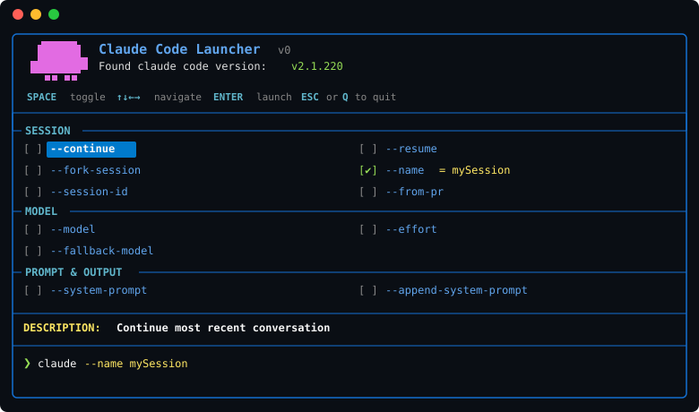

# claunch

A TUI launcher for [Claude Code](https://docs.anthropic.com/en/docs/claude-code). Toggle flags, enter values, and launch claude with your selected configuration — all from a visual checklist.

<p align="center">
  
</p>

## Features

- Two-column grid layout with grouped options
- Inline value display for options that take arguments
- Live command preview as you toggle options
- Export selected options as ultra-simple bash scripts (~8-10 lines)
- Sticky section headers while scrolling
- Countdown launch screen with ESC to cancel
- Pure bash — no external TUI libraries

## Requirements

- **bash 4+** (macOS ships bash 3.2 — install a newer version with `brew install bash`)
- **Claude Code** CLI installed and in your PATH

## Installation

```bash
git clone https://github.com/arjuhe/claunch.git
cd claunch
./install.sh    # symlinks to /usr/local/bin/claunch (uses sudo)
```

Or manually:

```bash
chmod +x claunch
cp claunch /usr/local/bin/   # or anywhere in your PATH
```

## Usage

```bash
./claunch          # launch the TUI
./claunch --help   # show help
```

### Controls

| Key | Action |
|-----|--------|
| `↑` `↓` `←` `→` | Navigate options |
| `SPACE` | Toggle option (prompts for value if needed) |
| `W` | Write selected options as standalone script |
| `ENTER` | Launch claude with selected options |
| `Page Up/Down` | Jump by group |
| `ESC` / `Q` | Quit |

### Exporting Scripts

Press `W` to save your selected options as a simple, clean bash script. If the file exists, claunch shows a red warning and asks for confirmation before overwriting (defaults to NO). After generating the script, claunch shows a goodbye screen with the logo and exits. The generated script is intentionally minimal — just the `exec claude` command with backslash line continuations. Simple, readable, easy to edit.

**Generated script features:**
- Ultra-clean ~8-10 line bash script
- Direct command with backslash line continuations
- One option per line
- Quoted values for safety
- Ready to run or edit

Perfect for creating reusable launch configurations! Edit the generated script to tweak your arguments without re-running claunch.

**Example generated script:**
```bash
#!/usr/bin/env bash
# /path/to/claude-launch
# Generated by claunch - https://github.com/arjuhe/claunch

exec claude \
  --continue \
  --model "sonnet" \
  --effort "high" \
  --add-dir "/home/user/project"
```

**Example goodbye screen:**
```
╭━━━━━━━━━━━━━┯━━━━━━━━━━━━━━━━━━━━━━━━━━━━━━━━━━━━
│             │ Script Generated Successfully!
│   ▐▛███▜▌   │ ✓ Wrote: ./claude-launch
│  ▝▜█████▛▘  │
│    ▘▘ ▝▝    │
│             │ Run it with: ./claude-launch
│             │ Happy coding! ◡̈
╰─────────────┴───────────────────────────────────────
```

Just copy and paste the command shown to run your launcher!

## License

[MIT](LICENSE)
